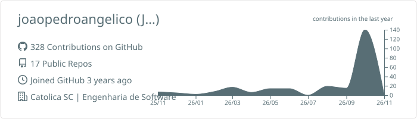
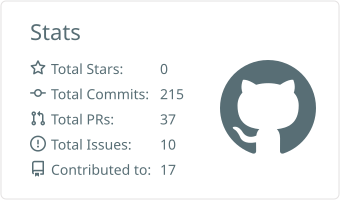
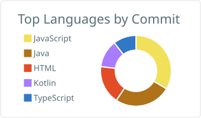

<h1 align="center">Meu nome é João Pedro Angélico</h1>

  Estudante de Engenharia de Software, técnico em ADS e atualmente instrutor de informática. 
  Gosto de transformar problemas do dia a dia em aplicativos simples e úteis.

  

---

### Um pouco sobre mim

- Moro em Joinville, Santa Catarina
- Curso Engenharia de Software na UniCatólica
- Dou aulas de informática para crianças (é um pouci divertido)
- Cuido de um laboratório com máquinas Ubuntu
- No momento, estou curtindo muito desenvolver apps mobile com Kotlin

---

### Com o que eu trabalho ou já trabalhei

  

---

### Projetos que eu gosto de mostrar

| Projeto | O que é | Stack |
|---|---|---|
| [ContasEmDia](https://github.com/joaopedroangelico/ContasEmDia) | App para organizar despesas sem dor de cabeça | Kotlin |
| [Doses](https://github.com/joaopedroangelico/Doses) | Lembra você de tomar o remédio na hora certa | Kotlin |
| [SuaPrivacidade](https://github.com/joaopedroangelico/SuaPrivacidade) | Avisa quando algum app usa sua câmera ou microfone | Kotlin |
| [UniCatólica](https://github.com/joaopedroangelico/UniCatolica) | Rede social acadêmica da UniCatólica (PAC VI) | TypeScript |
| [Rei da Coleta Seletiva](https://github.com/joaopedroangelico/Rei-da-Coleta-Seletiva) | Joguinho para ensinar a separar o lixo | Godot |
| [Barbearia Oliveira](https://github.com/joaopedroangelico/Barbearia-Oliveira) | Site para uma barbearia | JavaScript |

<b>Outros projetos e estudos</b>

 

- [Manutencao_OS](https://github.com/joaopedroangelico/Manutencao_OS) — gerenciamento de ordens de serviço (PHP)
- [Mecanica](https://github.com/joaopedroangelico/Mecanica) — controle de aulas de mecânica (PHP)
- [MFlix](https://github.com/joaopedroangelico/MFlix) — catálogo de filmes (EJS)
- [NewStrem](https://github.com/joaopedroangelico/NewStrem) — projeto server-side (HTML)
- [Estrutura_Web_Modelo_CRUD](https://github.com/joaopedroangelico/Estrutura_Web_Modelo_CRUD) — CRUD de programação web (JavaScript)
- [pangeia.github.io](https://github.com/joaopedroangelico/pangeia.github.io) — trabalho de UI e UX
- [AppTradutor](https://github.com/joaopedroangelico/AppTradutor) — app tradutor (HTML)
- [C_Sharp_Web](https://github.com/joaopedroangelico/C_Sharp_Web) e [Introducao_C_Sharp](https://github.com/joaopedroangelico/Introducao_C_Sharp) — primeiros passos em C#
- [Agenda-eEletronica](https://github.com/joaopedroangelico/Agenda-eEletronica) — agenda eletrônica em C, onde tudo começou

---

### Meus números

  

  
  

---

### Quer conversar?

Sempre disponível a trocar ideias, participar de projetos ou só bater um papo sobre tecnologia.

  
  

<i>"De pouquinho em pouquinho vamos longe."</i>

